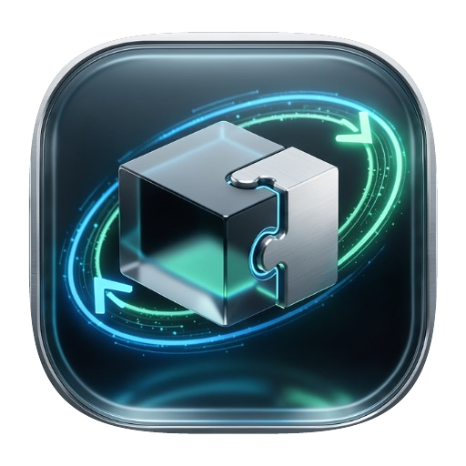
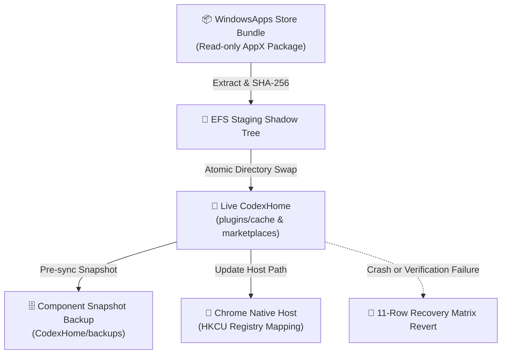
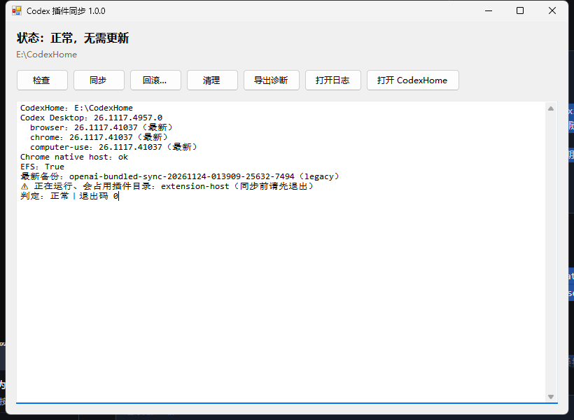

<div align="center">

<br/>

# ⚡ Codex Bundled Plugin Sync

**Windows utility for keeping Codex Desktop bundled plugins synchronized with a persistent local marketplace and cache.**

[](https://github.com/1254084397/codex-bundled-plugin-sync/releases/latest)
[](https://github.com/1254084397/codex-bundled-plugin-sync/actions/workflows/ci.yml)
[](https://github.com/1254084397/codex-bundled-plugin-sync)
[](https://dotnet.microsoft.com/)
[](LICENSE)
[](https://github.com/1254084397/codex-bundled-plugin-sync/releases)

<p align="center">
  <a href="https://github.com/1254084397/codex-bundled-plugin-sync/releases/latest"><b>📦 Download Latest Release (.zip)</b></a> ·
  <a href="#quick-start"><b>🚀 Quick Start</b></a> ·
  <a href="docs/DESIGN.md"><b>📐 Design Contracts</b></a> ·
  <a href="CHANGELOG.md"><b>📝 Changelog</b></a>
</p>

[English](#english) · [中文说明](#中文说明)

</div>

---

### ✨ Key Highlights

| Feature | Description |
| :--- | :--- |
| 🖥️ **Dual-Binary Distribution** | Compact WinForms GUI (`CodexPluginSync.exe`) + dedicated headless CLI (`CodexPluginSync.Cli.exe`). Zero external DLL dependencies. |
| 🛡️ **Zero-Loss Crash Recovery** | 7-stage transactional state machine with write-ahead journal and 11-row recovery matrix. |
| 🔒 **Enterprise EFS & Reparse-Safe** | Handles NTFS EFS encryption properly (`cipher /e` → `robocopy /COPY:DAT` → `cipher /d`), resolves directory junctions without infinite recursion. |
| 🔍 **SHA-256 Digest Verification** | Verifies copied trees against expected digests before any live directory swap occurs. |
| 🌐 **Chrome Native-Host Repair** | Resolves Chrome extension native messaging host drift automatically so browser automation never breaks. |
| ↩️ **One-Click Component Rollback** | Granular component snapshot backups. Roll back easily from GUI or CLI without wiping unrelated plugins. |
| 🔔 **Tray & Background Monitor** | System tray minimization (`NotifyIcon`), periodic background silent checks, and non-blocking update notifications. |



---

## English

Codex Desktop stores its bundled plugins inside a Windows AppX installation. A local Codex environment can also use a persistent marketplace and selected plugin caches under `CodexHome`. After a Store/Desktop update, these locations can drift apart.

This utility provides a safe, repeatable way to:

- Inspect whether synchronization is needed (zero-write check);
- Copy the persistent bundled-plugin marketplace;
- Update the managed browser, Chrome, and computer-use caches;
- Verify copied files with SHA-256 hashes;
- Update the Chrome native-messaging host path;
- Keep a rollback snapshot with granular component tracking;
- Clean stale stages and old logs safely.

### Why this exists

Codex Desktop ships its bundled plugins inside a Windows AppX package, and loads them from a *second* copy materialized into `CodexHome`. A Store update replaces the AppX side and drops the old install path, while the `CodexHome` copy stays where it was. Nothing reports the mismatch — the plugins simply stop working.

This utility keeps both sides in step: it compares the Desktop package, the local marketplace, and the plugin caches, then copies, verifies, backs up, and (if needed) rolls back.

**Who it is for**
- Codex Desktop users who rely on the bundled browser, Chrome, or computer-use plugins.
- Anyone whose `CodexHome` was moved, customized, or edited by hand.
- People who need to script the same operation across machines or in automated environments.

**Is it necessary?**
Yes, if you have ever lost the browser plugin after a Desktop update and went digging through `WindowsApps` by hand. Not really, if you never use the bundled plugins — nothing breaks for you. This tool has a limited lifespan by design: if a future Codex Desktop release re-materializes plugins on its own, `--check` will permanently report `Update needed: No` and the project can be archived. Run `--check` only, for a while, before trusting it with writes.

### Why the check is reliable

The AppX bundle can contain plugins that are not part of the persistent Marketplace materialization. The tool compares the local Marketplace against Codex's materialization key instead of treating every directory in the AppX bundle as persistent. This avoids the common repeated-update false positive caused by transient or app-internal plugins.

### Quick start

#### Option A: Graphic Interface (Recommended)

1. Download [`CodexPluginSync-<version>.zip`](https://github.com/1254084397/codex-bundled-plugin-sync/releases/latest) and unzip it.
2. Double-click `CodexPluginSync.exe` — that opens the desktop interface directly (compiled as WinExe, **zero black console window flash**).
3. Click **检查状态** to inspect the components (purely read-only).
4. If an update is needed, click **立即同步** (asks for confirmation and creates a backup first).

<div align="center">
  
</div>

#### Option B: Command Line Interface & Automation

For command-line usage, automated scripts, CI, and Windows Task Scheduler:

1. Close Codex Desktop, ChatGPT, Chrome, and Edge (and any Chromium browser loading the Codex extension — see *What blocks a sync* below).
2. Run the read-only check:
   ```bat
   CodexPluginSync.Cli.exe --check
   ```
   *(Or through the wrapper: `sync-codex-bundled.cmd --check`)*
3. If the check reports `Update needed: Yes`, run:
   ```bat
   CodexPluginSync.Cli.exe --sync
   ```
4. Restart Codex Desktop after synchronization succeeds.

Both entry points resolve `CodexHome` the same way. To use another location:
```bat
set CODEX_HOME=E:\CodexHome
CodexPluginSync.Cli.exe --check
```

> ⚠️ **Entry Point & Window Behaviour**:
> - **Regular Users**: Always double-click `CodexPluginSync.exe`. It never flashes or pops up a black console window.
> - **CLI / Scheduled Tasks / CI**: Call `CodexPluginSync.Cli.exe` or `sync-codex-bundled.cmd`.
> - **Wrapper Compatibility**: `sync-codex-bundled.cmd` is a CLI wrapper for automated scripts (mapping exit code `2` to `0`). Do not double-click `.cmd` to launch the GUI; `.cmd` is a console script by nature. With no arguments, `.cmd` pauses on exit so manual command runs stay visible. When invoking `.cmd` from Task Scheduler or CI, pass `--no-pause` or set `CODEX_NO_PAUSE=1` (or `CI=1`). Explicit arguments like `--check` or `--sync` never pause.

### What blocks a sync

The sync replaces whole directories, so anything holding a file inside them must be closed first. In practice that is not only Chrome/Edge: the Codex browser extension's `extension-host.exe` is started by whichever Chromium browser loads the extension, and some Codex helper processes restart it automatically.

If a sync is refused with `检测到会锁住插件目录的进程`, close the listed program (or add its process name to `extraLockingProcesses` in `%LOCALAPPDATA%\CodexPluginSync\settings.json`) and retry. The tool refuses before writing anything, and a failed run reverts automatically.

### Commands

| Command | Purpose | Writes plugin files? |
| --- | --- | :---: |
| *(no arguments)* | Open the GUI (`CodexPluginSync.exe`) or show CLI help (`CodexPluginSync.Cli.exe`) | No |
| `--check` | Show Desktop, Marketplace, cache, disk, and process status | No |
| `--sync` | Synchronize Marketplace and managed caches | Yes |
| `--rollback [--backup <id>]` | Restore a completed synchronization backup (newest by default) | Yes |
| `--cleanup-only [--dry-run]` | Remove old backups, stages, and logs | No plugin changes |
| `--export-diag [--out <path>] [--no-redact]` | Write a redacted diagnostic zip | No |
| `--selftest` | Run the built-in fixture suite (28 test cases) | No (temp dirs only) |
| `--help` | Print command help | No |

PowerShell scripts can also be called directly with `-Root`:
```powershell
powershell -ExecutionPolicy Bypass -File .\scripts\check-openai-bundled.ps1 -Root "$env:USERPROFILE\CodexHome"
powershell -ExecutionPolicy Bypass -File .\scripts\sync-openai-bundled.ps1 -Root "$env:USERPROFILE\CodexHome"
```

### Safety by design

- `--check` mode is strictly non-destructive.
- Source files in the AppX installation are read-only.
- Automatic component snapshot backup created before any directory is moved.
- Copied files are verified against SHA-256 tree digests before swapping.
- Comprehensive crash recovery journal with 11-row recovery matrix.
- Detailed logs saved under `%LOCALAPPDATA%\CodexPluginSync\logs` and `CodexHome\logs`.
- Zero credentials, tokens, or personal chat data are ever collected.

### Requirements

- **OS**: Windows 10 (1903+) or Windows 11 (x64 / ARM64 via emulation)
- **Codex Desktop**: Installed via Microsoft Store / AppX package
- **Runtime**: .NET Framework 4.8 (built-in on modern Windows 10 / 11)
- **Permissions**: Read access to WindowsApps AppX package and write access to `CodexHome`

---

## 中文说明

Codex Desktop 的内置插件（浏览器控制、Chrome 原生消息宿主、电脑操作等）打包在 Windows AppX 安装包中，运行时却从 `CodexHome` 目录中独立加载。

每次微软商店更新 Codex 桌面端后，AppX 物理路径变动，但 `CodexHome` 中的缓存不会自动刷新，导致扩展失联、插件报错失效。

本工具提供一套具备**事务安全保护、增量校验、EFS 加密支持与一键回滚**的自动化解决方案。

### 核心特性

- 🖥️ **双独立入口分发**：包含轻量 WinForms 桌面界面（`CodexPluginSync.exe`）与专用无头 CLI（`CodexPluginSync.Cli.exe`），零外部 DLL 依赖，开箱即用。
- 🛡️ **七阶段事务与零丢失崩溃恢复**：写前日志（Journal）+ 11 行恢复矩阵，无论写入中途断电还是进程强杀，均能自动回滚或收尾。
- 🔒 **企业级 EFS 加密与链接安全**：正确处理 Windows NTFS EFS 加密属性与目录 Junction，杜绝权限报错与无限递归。
- 🔍 **SHA-256 树指纹校验**：替换前对文件树做全量摘要比对，只有完全吻合才执行提交。
- 🌐 **Chrome Native Host 自动修补**：自动检测注册表原生消息宿主路径漂移并修复，确保浏览器扩展顺利重连。
- ↩️ **细粒度组件快照回滚**：只备份更新的项目，一键无损退回到任意历史备份。
- 🎨 **原生图标与托盘驻留**：内嵌全新设计的双色拼图 Squircle 品牌图标，支持无黑框最小化到系统托盘（NotifyIcon）、定期后台巡检与无打扰气泡提醒。

### 快速开始

#### 方式一：图形界面（推荐）

1. 下载最新发布包 [`CodexPluginSync-<版本>.zip`](https://github.com/1254084397/codex-bundled-plugin-sync/releases/latest) 并解压；
2. 双击运行 `CodexPluginSync.exe`（编译为 WinExe 纯窗体子系统，**双击绝不闪出黑色命令行黑框**）；
3. 点击 **【检查状态】**（只读体检，表格化查看各组件状态，不修改任何文件）；
4. 如果提示需要更新，点击 **【立即同步】**（执行前会自动弹窗二次确认并备份）。

#### 方式二：命令行与自动化操作

用于控制台脚本、计划任务或自动化工作流：

```bat
:: 1. 只读检查当前状态（可通过 Cli.exe 或 .cmd 包装器）
CodexPluginSync.Cli.exe --check

:: 2. 如果提示 Update needed: Yes，执行同步
CodexPluginSync.Cli.exe --sync

:: 3. 如需回滚到上一次备份
CodexPluginSync.Cli.exe --rollback
```

> ⚠️ **运行方式与窗口行为说明**：
> - **普通用户**：请直接双击 `CodexPluginSync.exe` 启动图形界面。在后台执行同步、检查或回滚时，已由统一进程层静默托管，绝不弹出任何 PowerShell、robocopy 或 cipher 窗口。
> - **命令行与计划任务**：请调用 `CodexPluginSync.Cli.exe` 或 `sync-codex-bundled.cmd`。
> - **批处理包装器兼容性**：`sync-codex-bundled.cmd` 仅作为自动化与旧脚本的 CLI 包装器（支持将 `--check` 的退出码 `2` 映射为 `0`）。**请勿将 `.cmd` 作为普通用户的 GUI 入口**。无参数启动时 `.cmd` 会在末尾执行 `pause` 方便查看输出；在计划任务或后台脚本中调用时，请追加 `--no-pause` 或设置环境变量 `CODEX_NO_PAUSE=1`（显式传入 `--check` / `--sync` 等参数时默认不等待）。

### 命令清单

| 命令 | 用途 | 是否修改插件文件？ |
| --- | --- | :---: |
| *(无参数)* | 运行 `CodexPluginSync.exe` 打开 GUI 界面；运行 `CodexPluginSync.Cli.exe` 打印命令行帮助 | 否 |
| `--check` | 只读检查桌面端、本地市场、缓存、磁盘与锁文件进程 | 否 |
| `--sync` | 执行事务同步并修补 Chrome 原生消息宿主 | 是 |
| `--rollback [--backup <id>]` | 回滚到指定或最新的完整同步快照 | 是 |
| `--cleanup-only [--dry-run]` | 清理过期暂存、废弃备份与历史日志 | 否（仅清理运维文件） |
| `--export-diag [--out <路径>]` | 导出脱敏的诊断压缩包（用于反馈问题） | 否 |
| `--selftest` | 运行内置 28 项自测试用例（仅使用临时目录） | 否 |
| `--help` | 显示完整命令行帮助 | 否 |

### 仓库结构

```text
.
├── src/CodexPluginSync/
│   ├── Program.cs                # 程序入口：GUI 双击直接运行，CLI 无参数打印帮助
│   ├── Cli/                      # 命令行解析、退出码、控制台格式化报告
│   ├── Core/                     # 事务状态机、ProcessRunner 静默进程管理、ConsoleManager、EFS 处理、哈希计算
│   └── Gui/                      # WinForms 桌面界面
├── build/
│   ├── CodexPluginSync.csproj    # WinExe 项目文件（GUI 入口，零控制台黑框）
│   ├── CodexPluginSync.Cli.csproj# Exe 项目文件（标准 CLI 控制台程序）
│   └── package.ps1               # 自动化构建、28 项自测与双入口发布打包脚本
├── scripts/                      # 早期 legacy PowerShell 参考实现
├── docs/                         # 设计规范 (DESIGN.md)、验收状态 (M1-STATUS.md)
├── sync-codex-bundled.cmd        # 兼容批处理包装器（禁用延迟展开，直接透传参数）
├── CHANGELOG.md                  # 版本演进记录
├── LICENSE                       # MIT 开源许可证
└── README.md
```

### 免责声明

本项目为开源社区非官方维护工具，与 OpenAI 官方无隶属关系。Codex Desktop 安装包机制可能随版本升级变动，建议更新后先点击“检查”再决定是否同步。

---

## License

This project is licensed under the [MIT License](LICENSE).
