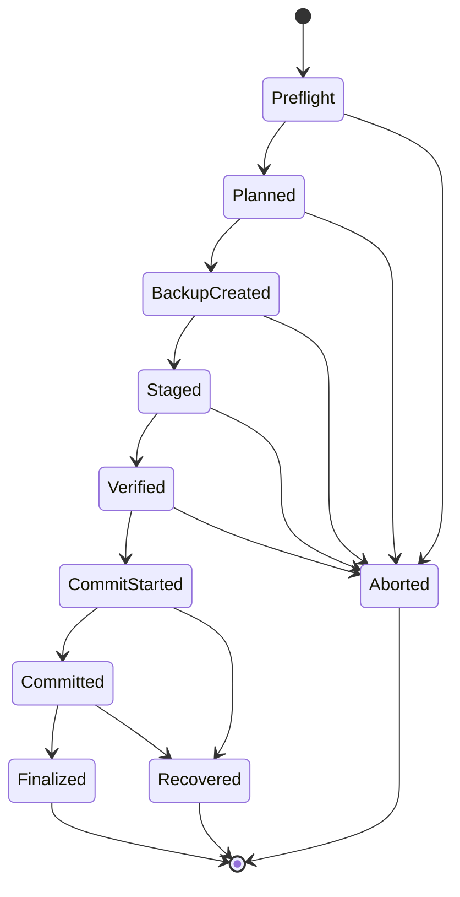

# 设计文档：Codex Bundled Plugin Sync

> 状态：**v0.3 — 契约冻结（M0）**，2026-06
> 适用：本仓库的图形界面（EXE）重构
> 相关：[README](../README.md) · [scripts/](../scripts/) · [sync-codex-bundled.cmd](../sync-codex-bundled.cmd)

**v0.3 相对 v0.2 的修订（M1 开工门槛评审）**

| # | 修订 | 位置 |
| --- | --- | --- |
| 1 | 新增"journal 只是提示、文件系统是唯一事实源"规则，并给出逐组件的 (live, backup, stage) 组合状态恢复矩阵，每行唯一动作 | §6.6 |
| 2 | journal 增加 `operationKind`，回滚拥有自己的状态机与阶段名 | §6.4、§7.3 |
| 3 | 明确日志根由操作类型决定：`--check` 不写 CodexHome，且不执行 EFS 能力探测 | §6.5、§7.1 |
| 4 | 备份完成判据闭合：每个组件移入后立即校验，`complete` 是合成判据 | §6.3、§7.2 |
| 5 | 清理/保留策略去掉自相矛盾，统一以 `backup.json` 的 `kind`/`status` 判定，不认目录名前缀 | §7.4 |
| 6 | Native host 回滚按"原来是否存在"决定恢复还是删除，空串不等于不存在 | §9.4 |
| 7 | EFS 探测的副作用与残留处置成契约；D-01 降级为"只撤销本次自己的变更" | §8.1、§8.2、§18.2 |
| 8 | AppX 包选择规则改为确定性排序 + 逐候选回落 | §7.1 |

**v0.2 相对 v0.1 的修订（按评审意见）**

| # | 修订 | 位置 |
| --- | --- | --- |
| 1 | 事务改为显式状态机；交换阶段不再承诺可取消；journal 逐阶段原子更新 | §6.4、§7.2、§11.1 |
| 2 | 备份改为"组件快照"，只记录本次实际改动的组件；回滚按快照执行 | §6.3、§7.3 |
| 3 | 明确"双独立入口分发"边界，不再称自包含 | §4.3 |
| 4 | EFS 提升为独立高风险契约，记录并恢复原加密状态 | §8 |
| 5 | 退出码与 `--json` 契约定稿，`.cmd` 做 2→0 兼容映射 | §13 |
| 6 | 进程关闭默认不强杀，区分检测/锁定/确认/超时 | §10 |
| 7 | Native Messaging 抽象 Chrome/Edge 并定义错误矩阵 | §9 |
| 8 | 诊断包默认脱敏，附 manifest 声明 | §7.5 |
| — | 里程碑重排为 M0–M5（契约 → Core → CLI → UI → 托盘 → 真机验收） | §17 |

---

## 1. 这个软件为什么存在

### 1.1 它解决的具体故障

Codex Desktop 以 Windows AppX（Microsoft Store 包）形式安装，内置插件位于安装目录内：

```
C:\Program Files\WindowsApps\OpenAI.Codex_<版本>_<架构>__<发布者哈希>\
  app\resources\plugins\openai-bundled\
```

Codex 运行时并不直接从安装目录加载插件，而是先用一份"物化（materialize）"到用户目录的副本：

| 位置 | 作用 |
| --- | --- |
| `%USERPROFILE%\CodexHome\.tmp\bundled-marketplaces\openai-bundled` | 持久化 Marketplace（插件市场源） |
| `%USERPROFILE%\CodexHome\plugins\cache\openai-bundled\<插件>\<版本>` | 浏览器 / Chrome / 电脑操作插件缓存 |
| `...\openai-bundled\.materialization-key` | Codex 记录的"本次实际物化了哪些插件、哪个版本" |

故障出在更新：

1. Store 更新整包替换 AppX 目录，路径里带版本号，旧目录被移除。
2. 用户目录里的 Marketplace 和缓存是**另一份拷贝**，不跟着更新。
3. Windows 不允许 Codex 回写 `WindowsApps`，也不保证每次启动都重新物化。

结果是一个极难自查的状态：Desktop 已是 26.2.0，浏览器插件仍在跑 1.4.0 的旧缓存，或 Chrome 扩展找不到 native messaging 宿主（`extension-host.exe` 的路径里嵌了旧版本号）。

### 1.2 它做的事，一句话

> 把 AppX 安装包里的内置插件，安全地同步到 `CodexHome` 的 Marketplace 和缓存目录，并修好浏览器的 native messaging 路径 —— 带校验、带备份、可回滚。

| 动作 | 内容 |
| --- | --- |
| **检查** | 比对 Desktop / Marketplace / 缓存三者，回答"要不要同步"，全程只读 |
| **同步** | 复制 → SHA-256 校验 → 交换目录；替换前备份；顺带修正 native messaging 路径 |
| **回滚** | 按备份快照把 Marketplace、缓存、native messaging 恢复到同步前的样子 |
| **清理** | 回收过期 stage、旧备份、旧日志 |

### 1.3 谁会用到它

| 用户 | 触发场景 | 关心什么 |
| --- | --- | --- |
| 普通 Codex Desktop 用户 | 更新后浏览器/电脑操作插件失灵、反复提示更新、Chrome 扩展连不上 | 点一下就修好 |
| 折腾型用户 | 切换版本、改过 `CODEX_HOME`、装在非系统盘 | 看清哪一项不一致，能回滚 |
| 企业/多机环境 | 批量部署、离线安装 | 可脚本化、退出码稳定、幂等 |
| 项目维护者 | 每次 Desktop 更新后重复同样手工操作 | 少踩坑、有日志能定位 |

### 1.4 有没有必要（诚实版）

**有必要：**

- 你把 Codex Desktop 当日常工具，且依赖浏览器 / Chrome / 电脑操作插件。Desktop 每次更新后，它们最容易静默失效，故障表现是"功能没了"而不是报错。
- `CodexHome` 被迁移、改过路径或手工动过，状态本身已漂移。
- 你需要可回滚 —— 手工复制粘贴出错后没有退路。

**没必要（别为了用而用）：**

- 只用对话/代码能力，从不用内置插件：同步不做也没有可感知影响。
- OpenAI 后续把物化逻辑改成"每次启动自检并重物化"。**这是最可能的失效路径**，一旦发生，`--check` 会长期返回"不需要更新"，项目该归档。
- macOS / Linux：路径与打包方式不同，不适用。

**判断标准**：如果你曾因 Desktop 更新后"浏览器插件突然不能用"去手工翻 `WindowsApps`，就需要它；从未遇到，先只跑 `--check` 观察一两个版本。

### 1.5 与官方的关系

非官方社区工具，不隶属 OpenAI，不修改 Store 应用文件。写入只发生在 `CodexHome`（或用户指定目录）与 `HKCU` 下的 native messaging 注册表项，且每次替换前留备份。AppX 安装目录**只读**。

---

## 2. 目标、非目标与已冻结契约

### 2.1 目标

1. **双独立入口分发**：GUI 与 CLI 两个独立程序开箱即用，零外部 DLL 依赖，不依赖仓库里的脚本。
2. **普通用户可用**：状态一眼看懂，主操作一个按钮，失败能看懂原因。
3. **比脚本更安全**：有状态机保证的事务、崩溃可恢复、任意备份可恢复。
4. **机器可用**：完整 CLI、稳定退出码、机器可解析的 JSON。
5. **可诊断**：一键导出脱敏诊断包。

### 2.2 非目标

- 不做 Codex 启动器、插件开发工具、网络代理。
- 不修改 AppX 安装目录、不绕过 Store 更新、不提供降级安装包。
- 不读写任何账号 / 凭据 / Token。
- 不做跨平台。
- 不自建插件市场、不下载第三方插件；只搬运 Desktop 自带的那份。

### 2.3 已冻结契约（M0 产物）

后续阶段不得单方面更改；如需变更走文档修订。

| 契约 | 内容 | 位置 |
| --- | --- | --- |
| C-1 事务状态机 | `Preflight → Planned → BackupCreated → Staged → Verified → CommitStarted → Committed → Finalized`，加上终止态 `Aborted` / `Recovered` | §6.4 |
| C-2 取消语义 | `CommitStarted` 之后不提供取消，只有"完成提交"或"恢复" | §7.2 |
| C-3 备份模型 | 组件快照，只记录实际改动的组件；回滚按快照执行，不硬编码组件集合 | §6.3 |
| C-4 退出码 | `0` 成功/无需更新 · `1` 执行错误 · `2` 仅 `--check` 表示需要更新 | §13 |
| C-5 JSON | 顶层 `schemaVersion`，`--json` 时 stdout 只有 JSON | §13.2 |
| C-6 EFS | 记录操作前状态与本次是否启用；仅撤销本次自己的开启，不改变用户既有状态（D-01）；不得用 `File.Copy` 替代 | §8 |
| C-7 NativeHost | Chrome 默认启用；Edge 未实测前不写注册表 | §9 |
| C-8 脱敏 | 诊断包默认脱敏并附 `manifest.json` | §7.5 |
| C-9 进程关闭 | 默认优雅关闭；强制结束需单独确认并记日志 | §10 |

### 2.4 兼容性策略

| 入口 | 现状 | v1.0 |
| --- | --- | --- |
| `sync-codex-bundled.cmd` 无参数 | 执行同步 | **保持**执行同步（内部改调 exe `--sync`） |
| `sync-codex-bundled.cmd --check` | 恒返回 0，输出 `Update needed: Yes/No` | 内部调 exe `--check`；**把 2 映射回 0**，并保留原文本行 |
| `scripts/*.ps1` | 直接可用 | 保留，标注 legacy；行为不保证与 exe 完全一致 |
| `CodexPluginSync.exe` 无参数 | — | 打开 GUI 并自动执行**只读检查**，绝不自动写入（见 D-07） |
| `CodexPluginSync.exe --help` | — | 输出帮助 |

---

## 3. 现状与三个限制

当前实现：`sync-codex-bundled.cmd` 负责菜单/日志/暂停，逻辑在 `scripts/*.ps1`（check 138 行、sync 306 行、cleanup 140 行、rollback 115 行）。

| 限制 | 具体表现 |
| --- | --- |
| 必须整包下载才能用 | 逻辑分散在 `scripts/`；只下 `.cmd` 或只下 exe 都跑不起来 |
| 纯 CLI，无进度 | 几百文件做 SHA-256 时界面静止，用户以为卡死；错误要从 PowerShell 堆栈里读 |
| 无崩溃恢复 | 复制中途被强杀会留下 `*.stage-*` 与半交换状态；下次只打印"发现上次未完成的 stage"，不修复 |

另外两个缺口，是本次重写重点修正的：

- **逐项交换无事务边界**：`sync-openai-bundled.ps1` 依次移动 Marketplace 与各缓存，中途失败会产生"Marketplace 已切换、两个缓存未切换"的混合状态，而脚本没有任何记录能判断落在哪一步。
- **回滚硬编码组件集合**：`rollback-openai-bundled.ps1` 要求 `marketplace.previous` 与三个 `cache-*.previous` 同时存在，与"只更新一项"的真实场景冲突。

---

## 4. 技术方案

### 4.1 技术决策

| 项 | 选择 | 理由 |
| --- | --- | --- |
| UI 框架 | WinForms | 界面复杂度不需要 XAML；启动快、体积小 |
| 目标框架 | `.NET Framework 4.8` | Win10 1903+ / Win11 预装运行时 |
| 构建 | in-box `MSBuild.exe` | 本地与 CI 均无需安装 SDK |
| 分发物 | `CodexPluginSync.exe` + `CodexPluginSync.Cli.exe`（双独立入口发布包） | GUI 与 CLI 独立，零外部 DLL 依赖 |
| 提权 | `asInvoker` | 现有流程不需要提权；需要时给提示而非直接弹 UAC |
| 进程模型 | 单进程 + 后台工作线程 | 运行时不依赖 PowerShell 脚本 |
| 第三方依赖 | 零（无 NuGet、无外置 DLL） | 降低供应链与杀软误报风险 |

不采用：Electron / Tauri（体积与复杂度不匹配）、Python + PyInstaller（AppX / 注册表 / EFS 贴合度差）、PowerShell + `ps2exe`（仍依赖脚本文件、误报率高）。

### 4.2 关键设计约束

**Core 层只接收显式路径参数，不自己调用 AppX API。**

```csharp
var engine = new SyncEngine(new SyncOptions {
    Root = @"D:\CodexHome",
    SourceBundle = @"C:\Program Files\WindowsApps\...\openai-bundled",
    BackupRoot = ...,
    Progress = ..., Log = ..., Cancellation = ...
});
```

现有脚本把 `Get-AppxPackage` 写死在函数内部，导致**无法在未安装 Codex Desktop 的机器上测试**。拆开"定位"与"操作"之后，CI 可以用 fixture 目录跑完整链路。对应隐藏参数 `--source-bundle <path>`（仅测试与手动救援使用，不出现在帮助里）。

### 4.3 "双独立入口分发"的准确边界

**不叫自包含（self-contained）**。精确表述：

| 项 | 事实 |
| --- | --- |
| 用户拿到的东西 | 双独立入口发布包：`CodexPluginSync.exe`（GUI）与 `CodexPluginSync.Cli.exe`（CLI） |
| 随程序分发的依赖 | 0 个（无 DLL、无 MSIX、无安装器、无配置文件） |
| 目标机必须已有 | .NET Framework 4.8（Win10 1903+ / Win11 预装；低于此版本不支持） |
| 视为环境依赖、不随程序分发 | `robocopy.exe`、`cipher.exe`（Windows 自带） |
| JSON 处理 | `DataContractJsonSerializer`（`System.Runtime.Serialization`，BCL）；不引入 JSON 库 |
| 资源 | 图标、字符串、默认设置以嵌入资源编译进程序集；不读外部文件 |
| 构建断言 | 各项目发布目录不产生多余私有或第三方 DLL，否则构建失败 |

发布文档统一用“双独立入口分发 (GUI + CLI，零外部 DLL 依赖)”，删除“self-contained / 零依赖”这类不准确措辞。

### 4.4 运行环境基线

- Windows 10 1903+ 或 Windows 11（x64 / ARM64 通过仿真）
- .NET Framework 4.8（`HKLM\SOFTWARE\Microsoft\NET Framework Setup\NDP\v4\Full` ≥ 528040 视为 4.8）
- 读取 AppX 安装目录与写入所选 `CodexHome` 的权限
- 启动时检测缺失运行时并给出明确提示（而不是 `TypeLoadException` 闪退）

---

## 5. 项目结构

```text
src/CodexPluginSync/
├── Program.cs                  # 入口：参数分派、单实例互斥、运行时检测
├── App.manifest                # asInvoker + PerMonitorV2 DPI + Win10 supportedOS
├── Cli/
│   ├── CliRunner.cs            # 参数解析、退出码映射、stdout/stderr 分流
│   └── JsonOutput.cs           # schemaVersion 包装与序列化
├── Core/
│   ├── Paths.cs                # CodexHome 探测、子路径集中定义
│   ├── AppxLocator.cs          # PackageManager 查询；失败回落 Get-AppxPackage 子进程
│   ├── CheckEngine.cs          # 只读，产出 StateSnapshot
│   ├── SyncEngine.cs           # 状态机驱动的事务
│   ├── RollbackEngine.cs
│   ├── CleanupEngine.cs
│   ├── BackupStore.cs          # 组件快照读写、枚举、恢复计划
│   ├── NativeHost/             # INativeHostProvider + Chrome / Edge provider
│   ├── Installer.cs            # robocopy / cipher 封装与 EFS 契约（§8）
│   ├── Hasher.cs               # SHA-256 批量校验 + 树摘要
│   ├── ProcessGuard.cs         # 检测 / 锁定判定 / 优雅关闭（§10）
│   ├── OperationJournal.cs     # 状态机持久化与恢复（§6.4）
│   ├── Logger.cs               # 文件日志 + 事件推送
│   ├── Settings.cs             # %LOCALAPPDATA%\CodexPluginSync\settings.json
│   ├── Redactor.cs             # 脱敏（§7.5）
│   └── DiagnosticsExporter.cs
├── UI/
│   ├── MainForm.cs             # 三页签，只消费 StateSnapshot 与事件
│   ├── TrayService.cs
│   └── Controls/
└── Resources/ app.ico, strings.zh-CN.resx, strings.en.resx

build/CodexPluginSync.csproj
tests/fixture/                  # 伪造 CodexHome + 伪造 openai-bundled
.github/workflows/build.yml
scripts/*.ps1                   # legacy
docs/DESIGN.md                  # 本文档
```

---

## 6. 数据模型

### 6.1 `StateSnapshot`

检查结果，同时是 `--json` 的 `state` 字段。

```jsonc
{
  "schemaVersion": 1,
  "tool": { "name": "CodexPluginSync", "version": "1.0.0" },
  "command": "check",
  "exitCode": 2,
  "state": {
    "timestampUtc": "2026-06-12T06:32:05Z",
    "codexHome": "D:\\CodexHome",
    "desktop": { "found": true, "version": "26.1.2", "packageFullName": "OpenAI.Codex_26.1.2.0_x64__..." },
    "marketplace": {
      "exists": true, "needsUpdate": false,
      "desktopPlugins": [ { "name": "browser", "version": "1.4.0" } ],
      "localPlugins":   [ { "name": "browser", "version": "1.4.0" } ],
      "materialized":   [ { "name": "browser", "version": "1.4.0" } ]
    },
    "components": [
      { "type": "cache", "name": "browser", "expected": "1.4.0", "actual": "1.4.0", "state": "ok" },
      { "type": "cache", "name": "chrome",  "expected": "1.4.0", "actual": "1.3.2", "state": "outdated" },
      { "type": "cache", "name": "computer-use", "expected": "1.0.1", "actual": null, "state": "missing" }
    ],
    "nativeHost": {
      "chrome": { "state": "outdated", "registered": true, "manifestPath": "...", "targetPath": "..." },
      "edge":   { "state": "not-checked", "registered": null }
    },
    "efs": { "stagingParentEncrypted": false, "encryptionSupported": null },   // --check 不探测能力，只能为 null
    "lockingProcesses": [ { "name": "chrome", "pid": 1234, "hasWindow": true } ],
    "fileLocks": [],
    "disk": [ { "drive": "D:", "freeBytes": 45210000000 } ],
    "backups": { "count": 1, "newest": { "backupId": "20260601-101500", "status": "complete" } },
    "journal": null,
    "environment": { "osBuild": "26100", "dotnetRelease": 533320, "isAdmin": false },
    "verdict": "update-needed"
  }
}
```

`state` 取值：`ok` / `outdated` / `missing` / `unknown`。`verdict`：`ok` / `update-needed` / `blocked` / `error` —— UI 与自动化只消费 `verdict`，不自行推导。

### 6.2 `settings.json`

位置：`%LOCALAPPDATA%\CodexPluginSync\settings.json`（不放 CodexHome，换 Root 不丢配置）。

```jsonc
{
  "schemaVersion": 1,
  "codexHome": "D:\\CodexHome",
  "language": "auto",
  "theme": "auto",
  "runAtStartup": false,
  "autoCheckHours": 0,
  "keepBackups": 1,
  "staleStageHours": 24,
  "keepLogDays": 30,
  "partialBackupRetentionDays": 7,
  "failedBackupRetentionDays": 30,
  "minimumFreeGB": 1,
  "extraLockingProcesses": [],
  "allowForceClose": false,
  "edgeNativeHost": "disabled",
  "confirmBeforeSync": true
}
```

读取失败或 schema 不识别时回落默认值并记日志，不阻塞启动。

### 6.3 备份模型：组件快照（C-3）

**每个备份只描述"本次实际改动了什么"**，回滚按 `components` 执行，不要求任何默认集合存在。

`backups/<backupId>/backup.json`：

```jsonc
{
  "schemaVersion": 1,
  "backupId": "20260612-143200",
  "kind": "sync",                       // sync | rollback-safety
  "status": "complete",                 // complete | partial | verify-failed
  "createdUtc": "2026-06-12T06:32:00Z",
  "toolVersion": "1.0.0",
  "appx": {
    "packageFullName": "OpenAI.Codex_26.1.2.0_x64__8wekyb3d8bbwe",
    "version": "26.1.2"
  },
  "components": [
    {
      "type": "marketplace",            // marketplace | cache
      "name": "marketplace",
      "livePath": "D:\\CodexHome\\.tmp\\bundled-marketplaces\\openai-bundled",
      "backupPath": "marketplace.previous",   // 相对 backupId 目录；不存在时为 null
      "existedBefore": true,
      "fileCount": 260,
      "sizeBytes": 18342117,
      "filesSha256": "3f9c…",           // 排序后的 (相对路径, sha256) 列表摘要
      "verifyState": "ok",             // ok | missing | mismatch（移入备份后立即校验的结果）
      "verifiedUtc": "2026-06-12T06:32:07Z",
      "fromVersions": [ { "name": "browser", "version": "1.3.2" } ],
      "toVersions":   [ { "name": "browser", "version": "1.4.0" } ]
    },
    {
      "type": "cache", "name": "chrome",
      "livePath": "D:\\CodexHome\\plugins\\cache\\openai-bundled\\chrome",
      "backupPath": "cache-chrome.previous",
      "existedBefore": true, "fileCount": 41, "sizeBytes": 8412311
    },
    {
      "type": "cache", "name": "computer-use",
      "livePath": "...\\computer-use",
      "backupPath": null,
      "existedBefore": false,           // 本次新建 → 回滚时删除
      "fileCount": 12, "sizeBytes": 2200331
    }
  ],
  "nativeHost": [
    {
      "browser": "chrome",
      "registryPath": "HKCU\\Software\\Google\\Chrome\\NativeMessagingHosts\\com.openai.codexextension",
      "registryValueExisted": true,
      "previousManifestPath": "C:\\Users\\u\\AppData\\Local\\…\\com.openai.codexextension.json",
      "manifestBackup": "native-chrome.json.previous",
      "previousTargetPath": "…\\chrome\\1.3.2\\extension-host\\…\\extension-host.exe"
    }
  ]
}
```

约束：

- `components` 为空时不允许写 `status: complete`（没有改动就不该有备份）。
- `filesSha256` 复用 §7.2 的校验遍历结果，不额外读盘。
- `backupPath` 为 `null` + `existedBefore:false` 表示"本次新建"，回滚语义是删除。
- **备份内容的写入时机**：`BackupCreated` 只建骨架（目录、`backup.json`、空间预检），原 live 内容在该组件进入 `CommitStarted` 时才移入 `backupPath`。这样 `Verified` 之前 live 完全未被触碰，且不产生额外的全量拷贝 IO（避免备份占用翻倍）。

**校验与完成判据（v0.3 闭合）**

```text
每个组件 live → backupPath 移动完成后，立即：
  1 重新枚举 backupPath，比对 fileCount / sizeBytes
  2 重算 filesSha256，与移动前记录的摘要比对
  3 通过 → verifyState=ok, verifiedUtc=now；不通过 → verifyState=mismatch，写盘即落定
```

| 条件 | status | 回滚可用性 |
| --- | --- | --- |
| 所有组件的 `verifyState=ok` **且** 所有新 live 树摘要通过 | `complete` | 可用 |
| 任一组件 `verifyState!=ok`，或未走到 `Committed` | `partial` | 拒绝（§7.3 第 2 步） |
| 移动/校验过程抛出异常，内容不可信 | `verify-failed` | 拒绝 |

- `status: complete` 是**合成判据**，不是某个步骤结束时顺手写下的字符串；任何组件未通过校验都不得进入 `Committed`（§7.2）。
- `components` 为空时不允许写 `status: complete`。
- `status: partial` / `verify-failed` 表示骨架已建但内容不可信。**UI 中不可恢复**；保留规则见 §7.4，不再使用"默认保留 keepLogDays 后回收"这类与 §7.4 冲突的表述。

### 6.4 操作日志与状态机（C-1）

`CodexHome\pending-operation.json`，原子写（临时文件 + 落盘 + `File.Replace`），每次状态变更都整文件重写。

```jsonc
{
  "schemaVersion": 1,
  "operationKind": "sync",             // sync | rollback（v0.3 新增，决定恢复走哪套阶段名）
  "operationId": "20260612-143200",
  "seq": 7,
  "updatedUtc": "2026-06-12T06:32:07Z",
  "phase": "commit-started",
  "backupId": "20260612-143200",
  "safetyBackupId": null,               // rollback 专用：kind=rollback-safety 的快照 id
  "appxVersion": "26.1.2",
  "targets": [
    { "component": "marketplace", "stagePath": "...stage-20260612-143200", "livePath": "...openai-bundled",
      "backupPath": "...backups\\20260612-143200\\marketplace.previous",
      "oldDigest": "3f9c…", "newDigest": "a71e…", "existedBefore": true,
      "swappedOut": true, "swappedIn": false, "verifiedUtc": "2026-06-12T06:32:07Z" },
    { "component": "cache:chrome", "stagePath": "...", "livePath": "...", "backupPath": "...",
      "oldDigest": "…", "newDigest": "…", "existedBefore": true,
      "swappedOut": false, "swappedIn": false, "verifiedUtc": null }
  ],
  "efs": { "preEncrypted": false, "enabledByThisRun": true, "restoredUtc": null },
  "nativeHost": [ { "browser": "chrome", "applied": false } ]
}
```

**状态机（唯一合法迁移）：**



`CommitStarted` 之后没有 `Aborted` 出口；`Recovered` 若还原不完整则降级为 `needs-attention`（同样是终态，但保留 journal 与快照等待人工处理）。

| 阶段 | 进入条件 | 已完成的事实 |
| --- | --- | --- |
| `Preflight` | 启动 | 路径、磁盘、进程、EFS 能力已确认 |
| `Planned` | 预检通过 | 已算出要动的组件集合与备份路径，**此时写 journal** |
| `BackupCreated` | 备份骨架建立（目录、`backup.json`、空间预检） | 有确定的回滚落点；**live 尚未移动** |
| `Staged` | 全部 stage 复制完成 | 新内容就位但未生效 |
| `Verified` | SHA-256 全量一致 | 新内容正确 |
| `CommitStarted` | 开始第一次 live 交换 | **从此不可取消** |
| `Committed` | 所有组件交换完成 | 新内容已生效 |
| `Finalized` | native host 已处理、`backup.json` 写完 | 收尾完成，删除 journal |
| `Aborted` | 任一阶段在 `CommitStarted` 之前失败/取消 | stage 清理，live 原样 |
| `Recovered` | `CommitStarted` 之后失败，已还原 | live 恢复到交换前 |

**原子性要求：**

- journal 写入失败（磁盘满、权限）→ 在任何 live 移动之前终止，按 `Aborted` 处理。
- 每次迁移前先写新 phase，再执行动作（write-ahead）；动作失败则 phase 已指向"正在做"，恢复逻辑能识别。
- `seq` 单调递增，用于识别被截断的写入。

**回滚阶段（v0.3 新增，`operationKind=rollback`）**

回滚本身也是多步移动，必须有自己的 journal 与阶段名，共用同一 schema：

```text
rollback-preflight → rollback-safety-created → rollback-commit-started
                   → rollback-committed → rollback-finalized
```

| 阶段 | 进入条件 | 已完成的事实 |
| --- | --- | --- |
| `rollback-preflight` | 启动 | 备份可选、`status=complete`、逐组件备份内容已校验 |
| `rollback-safety-created` | 预检通过 | 当前 live 已**完整**复制进 `kind=rollback-safety` 快照并校验通过 |
| `rollback-commit-started` | 安全快照落定 | 从此不可取消，**只允许移动 live** |
| `rollback-committed` | 所有组件已换上备份内容 | 目录层已回滚 |
| `rollback-finalized` | native host 已恢复 + 逐组件校验通过 | 删除 journal |

硬规则：

1. **安全快照复制完成并校验通过之前，一行 live 都不允许移动**（v0.2 只写了"建快照"，没约束校验时机）。
2. `rollback-finalized` 之前的逐组件校验必须包含 **native host 项**，否则会出现"目录回去了、注册表还指着新版、journal 已清除"。
3. 回滚自身崩溃后的恢复走 §6.6 同一矩阵（`livePath` 侧是 live，`backupPath` 侧是备份内容，`stagePath` 位置由安全快照代替）。

### 6.5 日志格式

日志根由**操作类型**决定，这是 v0.3 的硬约束（v0.2 在此处自相矛盾：既要求 `--check` 不写 CodexHome，又把日志固定在 `CodexHome\logs`）：

| 操作 | 日志根 | 文件名 |
| --- | --- | --- |
| `--check`（含 GUI 自动检查） | `%LOCALAPPDATA%\CodexPluginSync\logs` | `check-<yyyyMMdd-HHmmss>.log` |
| `--sync` / `--rollback` / `--cleanup-only` | `CodexHome\logs` | `sync-openai-bundled-<stamp>.log` / `rollback-<stamp>.log` |
| `--export-diag` | 无新日志（只收集） | — |

`--check` 如果连 `%LOCALAPPDATA%` 日志也写不了，就只输出 stdout/stderr，**不得因此失败**。

行首 `[HH:mm:ss]`，结构化字段在同一行末尾：

```
[14:32:06] phase=verify file=128/260 result=ok
[14:32:07] phase=native-host browser=chrome result=updated
[14:32:09] phase=finalized backup=20260612-143200 result=ok
```

日志仅追加，不轮转覆盖；轮转交给清理流程。

### 6.6 崩溃恢复的事实源与组合状态矩阵（v0.3 新增，P1）

v0.2 的恢复规则残缺在于：它假设 `journal.targets[].swappedIn` 能代表磁盘真相。但"动作已执行、记录尚未更新"的窗口客观存在：

```text
写 journal(commit-started) → 执行 live → backup → 【此时崩溃】→ 本应写 swappedOut=true
```

因此定下三条硬规则：

1. **journal 只是提示，文件系统是唯一事实源。** 恢复时不得仅凭 `swappedOut`/`swappedIn` 推导状态。
2. **每个组件的恢复判定输入是三元组的存在性 + 树摘要**：`livePath`、`backupPath`、`stagePath`（回滚时第三项由 `kind=rollback-safety` 快照路径代替）。摘要取自 journal 的 `oldDigest`/`newDigest` 与 `backup.json` 的 `filesSha256`；摘要不匹配即视为"内容不可识别"。
3. **矩阵必须全覆盖且每行唯一动作**；任何一行都不匹配 → `needs-attention`，保留 journal 与快照，提示导出诊断，绝不猜。

矩阵（L=live，B=backup，S=stage；"旧/新"指摘要与 `oldDigest`/`newDigest` 一致）：

| # | L | B | S | 解读 | 唯一动作 | 终态 |
| --- | --- | --- | --- | --- | --- | --- |
| 1 | 旧 | 无 | 无 | 尚未备份、未交换 | 无操作（live 未动） | `Aborted` |
| 2 | 旧 | 无 | 新（完整） | 已 staged、未 commit | 删除 S | `Aborted` |
| 3 | 旧 | 旧 | 无 | 备份已生成但 live 未动 | 删 S（无），保留 B 作回滚点 | `Recovered` |
| 4 | 无 | 旧 | 新（完整） | 交换第 1 步完成、第 2 步未做 | S → L，校验；失败则 B → L | `Recovered` / `needs-attention` |
| 5 | 新 | 旧 | 无 | 交换完成 | 无操作 | `Committed` → 继续收尾 |
| 6 | 新 | 旧 | 新（残留） | 完成但 stage 未清 | 删 S | `Committed` → 继续收尾 |
| 7 | 新 | 无 | 无 | `existedBefore=false` 的新建组件 | 无操作 | `Committed` → 继续收尾 |
| 8 | 无 | 旧 | 无 | 交换中途 stage 丢失 | B → L，校验 | `Recovered` / `needs-attention` |
| 9 | 无 | 无 | 无 | 没有任何副本 | 不得自动处理 | `needs-attention` |
| 10 | 旧 | 旧 | 新（完整） | 三份齐全且未交换 | 删除 S，保留 B | `Aborted` |
| 11 | 其他（摘要既非旧也非新 / 树损坏） | 任意 | 任意 | 内容不可识别 | 不得自动处理 | `needs-attention` |

配套约束：

- 每个组件的迁移必须是**整目录 rename/move**，禁止逐文件写入 live——否则矩阵的"完整旧版/完整新版"不变量无法成立。
- `needs-attention` 时必须保留：journal、备份目录、stage（若存在），并在 UI 与 `--json` 的 `verdict` 里显式暴露为 `blocked`。
- 恢复动作本身也要写日志（`phase=recover component=… row=4 result=ok`），便于事后对账。
- `--check` 只读取并报告 journal 与矩阵初判，**不执行任何恢复动作**。

---

## 7. 核心流程

### 7.1 检查（只读）

```text
1 定位 AppX（确定性选择，见下）→ 记录 packageFullName + version
2 校验必需路径（sourceBundle / marketParent / CodexHome）
3 读 Desktop 侧插件清单（plugins\*\.codex-plugin\plugin.json）
4 读本地 Marketplace 清单
5 读 .materialization-key；缺失时回落 Desktop 的 .agents\plugins\marketplace.json
6 expected = key ∩ desktop（按 name），与 local 比对 → marketplace.needsUpdate
7 逐组件读缓存版本 → ok / outdated / missing
8 探测 native host（Chrome；Edge 视开关）
9 枚举占用进程、磁盘、备份、journal
10 verdict
```

**为什么用 `.materialization-key` 而不是"AppX 里有什么就同步什么"**：AppX 包内存在不参与持久化的插件（内部/临时），按目录比对会造成"每次检查都提示更新"的假阳性。这是现有实现最关键的正确性设计，必须保留。

只读性约束（v0.3 收紧）：检查阶段**不得**：

- 在 `CodexHome` 下创建任何文件或目录（包括 `logs`、`backups`、stage 目录）；实现上禁止调用任何 `EnsureDirectories()` 类辅助方法；
- 向 `CodexHome` 写日志（日志根见 §6.5）；
- 执行 EFS 能力探测（探测需要建临时文件，见 §8.1）；只能读 `Encrypted` 属性；
- 写注册表、修 manifest、删除 stage、执行恢复动作；
- `--json` 时往 stdout 写任何非 JSON 内容。

后置断言（必须在 `--selftest` 覆盖）：对 `CodexHome` 子树做"相对路径 + 长度"指纹，`--check` 前后必须逐字节一致。

**AppX 包选择规则（v0.3 新增，确定性排序）**

同一台机器可能存在多个 `OpenAI.Codex` 包（旧版本、其他用户、framework/resource 包）。选择必须是确定性的，否则不同机器会得到不同源目录：

```text
1 过滤：当前用户已注册（Get-AppxPackage 无 -AllUsers）、IsFramework=false、
       非 resource-only、架构与当前进程/OS 架构匹配
2 排序：Version 降序 → InstallLocation 存在 → app\resources\plugins\openai-bundled 存在
3 依次尝试候选，直到找到可读的 openai-bundled；全部失败才报"未安装 / 路径缺失"
4 版本以包版本为准；目录内 plugin.json 版本仅用于对账，两者不一致时日志 WARN
   并在 StateSnapshot 里同时报告（不得静默取其中一个）
```

回落策略：`PackageManager` 查询抛异常或返回空时使用 `Get-AppxPackage` 子进程；两条路径必须返回同一结构，并写入日志的是哪一条生效。

### 7.2 同步事务（状态机驱动）

```text
Preflight     路径 / 磁盘 / 进程 / EFS 能力 / 运行时
              ↓ 写 journal(phase=planned)
Planned       组件集合 + 备份路径确定
              ↓ 写 journal(phase=backup-created)
BackupCreated 建 backupId 目录 + backup.json 骨架(status=partial) + 空间预检 + 记录 existedBefore
              ↓（live 不动）
Staged        robocopy → stage（含 §8 的 EFS 序列）
              ↓
Verified      SHA-256 全量比对（进度事件）+ 计算 filesSha256
              ↓ 写 journal(phase=commit-started)
CommitStarted 逐组件：先移 live → backupPath（置 swappedOut=true）→ **立即重算摘要校验**
              → 再移 stage → live（置 swappedIn=true）；摘要比对通过才置 verifiedUtc
              ↓
Committed    仅当所有组件 verifyState=ok 且新 live 树摘要通过：
              写 backup.json(status=complete, components=实际改动项)
              否则写 status=verify-failed 并终止（不得进入 Finalized）
              ↓
Finalized    处理 native host（含 §9.4 存在性位）→ 删除 journal → 事件完成
```

**任何阶段失败（v0.3 修订）：**

失败后的处置不再按"journal 标记"推导，而是按 §6.6 矩阵对每个受影响组件独立判定（盘中状态为事实）。阶段层面只决定"还要不要继续做"：

| 失败位置 | 动作 | 终态 |
| --- | --- | --- |
| `Preflight` / `Planned` | 不移动任何 live；若已建骨架则删骨架 | `Aborted` |
| `BackupCreated` / `Staged` / `Verified` | 删 stage 与未填充的备份骨架，live 未动 | `Aborted` |
| `CommitStarted` 之后 | 逐组件套用 §6.6 矩阵；全部回到"完整旧版" → `Recovered`；任何一行落到 `needs-attention` → 停止并暴露 | `Recovered` / `needs-attention` |
| 备份校验未通过（`verifyState!=ok`） | 不得进入 `Committed`；按 `partial`/`verify-failed` 收尾 | `Aborted` |

**关键不变量：**

1. 任何时刻，每个组件的 live 目录要么是完整旧版本、要么是完整新版本，不出现混合内容（依靠整目录 rename）。
2. `Verified` 之前 live 完全未被触碰。
3. `CommitStarted` 之后不存在"取消"，只有"完成"或"恢复"。
4. `needs-attention`（恢复也失败或矩阵无匹配行）必须显式暴露给用户，不静默留在半状态。
5. **`status=complete` 只在所有组件备份树与新 live 树均校验通过后才允许写**；反过来，任何 `verifyState!=ok` 都必须阻止进入 `Committed`。

**启动时的恢复分支（阶段层派发，组件层由 §6.6 决定）：**

| journal.phase | `operationKind` | 判定 | 动作 |
| --- | --- | --- | --- |
| `preflight` / `planned` | sync | 尚未建骨架 | 删残留骨架与 journal → `Aborted` |
| `backup-created` / `staged` / `verified` | sync | 尚未交换 | 删 stage 与未填充骨架 → `Aborted` |
| `commit-started` / `committed` | sync | 可能部分交换 | 逐组件跑 §6.6 矩阵 |
| `finalized`（journal 残留） | sync | 收尾中断 | 补写 `backup.json`（若缺）后删除 journal |
| `rollback-preflight` / `rollback-safety-created` | rollback | 安全快照已定、live 未动 | 删未完成的回滚骨架 → `Aborted` |
| `rollback-commit-started` / `rollback-committed` | rollback | 目录层可能已部分回滚 | 逐组件跑 §6.6 矩阵（S 位由安全快照代替）；未完成 native host 恢复则先补再清 journal |
| 任何 phase | 任意 | journal 损坏/无法解析 | 不自动删除；提示路径并要求选"回滚到最新完整备份"或"忽略" |

### 7.3 回滚（按快照执行，自有状态机）

```text
1 选择备份：--backup <id> 或默认最新 status=complete（按 backup.json 的 createdUtc，不按目录名）
2 读 backup.json → components 与 nativeHost；status!=complete 直接拒绝（partial / verify-failed 不可回滚）
3 逐组件校验：existedBefore=true → backupPath 存在且 fileCount/size/filesSha256 全匹配
              existedBefore=false → 不需要 backupPath（回滚语义=删除）
   → 写 journal(operationKind=rollback, phase=rollback-preflight)
4 建 rollback-safety 快照（当前 live），写完立即校验树摘要
   → 校不过就不允许继续；通过了才写 journal(phase=rollback-safety-created)
5 写 journal(phase=rollback-commit-started) → 逐组件：live → 安全快照；备份内容 → live
   existedBefore=false 的组件：live → 安全快照，然后删除
6 native host 恢复：manifest 字节 + 注册表值（按 §9.4 的存在性位）
7 逐组件校验（目录 manifest 可读 **且** native host 项已还原）
   → 写 journal(phase=rollback-committed) → 写安全快照 backup.json(status=complete)
   → 写 journal(phase=rollback-finalized) → 删除 journal
8 失败/崩溃 → 走 §6.6 矩阵；不可自动恢复则保留 journal 与两个快照 → needs-attention
```

与 v0.2 的差异：

- 组件集合由快照决定，**不再要求四个备份同时存在**（旧布局 `marketplace.previous` / `cache-*.previous` 作为 legacy 子集只读兼容）；
- 支持任意 `backupId`；
- 安全快照**校验通过之前不动 live**；
- 回滚有自己的 journal，强杀后能区分"live 已移走但备份未回"与"部分组件已回滚"。

### 7.4 清理

保持现有安全策略（路径越界防护、junction 不递归、只删自己创建的命名模式）。v0.3 先统一命名与归属，否则清理器和回滚选择器会互相踩：

| 目录 / 文件 | 归属者 | 命名 | 身份认定依据 |
| --- | --- | --- | --- |
| 同步备份 | Sync | `backups\<backupId>\` | `backup.json.kind=sync` |
| 回滚安全快照 | Rollback | `backups\<backupId>\` | `backup.json.kind=rollback-safety` |
| 旧版布局备份 | legacy | `backups\openai-bundled-sync-*` | 目录名前缀（仅兼容读取） |
| stage | Sync | `<marketParent>\openai-bundled.stage-*`、`<cacheParent>\<plugin>.stage-*` | **只看 journal.targets，不猜目录名** |
| 日志 | 按操作类型 | `CodexHome\logs\*.log`、`%LOCALAPPDATA%\CodexPluginSync\logs\*.log` | 文件名前缀 |

**保留规则（v0.3 解决 v0.2 中"partial 保留 keepLogDays"与"partial 永不删"的直接矛盾）**：

| 目标 | 规则 |
| --- | --- |
| 空备份目录 | 无条件删除（失败运行的残留） |
| 当前 journal 引用的任何目录（stage / backup / safety） | **永不自动删除** |
| `status=complete` 的备份 | 按 `createdUtc` 倒序保留 `keepBackups` 个；`keepBackups` **只统计 complete** |
| `status=partial` 的备份 | 不被 journal 引用时，超过 `partialBackupRetentionDays`（新增设置，默认 7）才删；被引用则永不自动删 |
| `status=verify-failed` 的备份 | 单独按 `failedBackupRetentionDays`（默认 30）保留，不计入 `keepBackups` |
| `kind=rollback-safety` 快照 | 保留最新 1 个（当前 journal 引用的除外） |
| stage 目录 | 只删"存在超过 `staleStageHours` **且** 不被任意 journal 引用"的 |
| 日志 | 早于 `keepLogDays` 才删；当前运行正在写的日志不删 |

清理器不得依赖目录名前缀判断身份（回滚选择器同理）：**一律读 `backup.json` 的 `kind`/`status`**，只有 legacy 目录才回退到前缀判断。

### 7.5 诊断导出与脱敏（C-8）

生成 `CodexPluginSync-diag-<stamp>.zip`：

| 文件 | 内容 | 默认脱敏 |
| --- | --- | --- |
| `state.json` | `StateSnapshot` | 是 |
| `journal.json` | 当前 journal（若存在） | 是 |
| `backups.json` | 备份清单（只含元数据，不含文件） | 是 |
| `logs/*.log` | 最近 5 个 | 是 |
| `settings.json` | 当前配置 | 是 |
| `native-host.txt` | 注册表键/值与 manifest 内容 | 是 |
| `environment.txt` | OS build、.NET release、是否管理员、DPI、区域 | 是 |
| `manifest.json` | 每个文件的用途与是否已脱敏 | — |
| `README.txt` | 如何提交 issue、每个文件是什么 | — |

**默认脱敏规则（`Redactor`）：**

| 目标 | 替换为 |
| --- | --- |
| 用户名（`%USERNAME%`） | `<user>` |
| 计算机名 | `<host>` |
| `C:\Users\<user>` 及自定义 CodexHome 的完整上级链 | `<profile>` / `<codexhome>`，保留盘符 |
| 用户 SID（`S-1-5-21-…`） | `<sid>` |
| 临时目录 | `<temp>` |
| 环境变量 | 仅白名单（`OS`、`PROCESSOR_ARCHITECTURE`、`DOTNET_*`、脱敏后的 `COMPUTERNAME`/`USERPROFILE`）；其余不导出 |
| 注册表路径中的用户名 | `<user>` |

**硬保证**：不含 token / API key / cookie / 插件文件内容 / AppX 文件 / 对话数据。`--export-diag --no-redact` 存在但必须显式传参，且 zip 内 `manifest.json` 标记 `"redacted": false`。

---

## 8. EFS 契约（C-6，高风险）

现有实现对 `marketParent` 执行 `cipher /e`，即**在用户目录上开启 EFS**，目的是让 `robocopy /COPY:DAT` 能写入 Application Protected 源文件；随后对 stage 执行 `cipher /d` 解除。这段逻辑不是复制细节，而是会改变用户目录加密状态的操作，因此单独立契约。

### 8.1 事实与要求

| 观察 | 要求 |
| --- | --- |
| 源文件带 EFS/Application Protected 属性 | 复制后 stage 树内**不得**残留 Encrypted 属性（现有实现会复查并抛错，保留） |
| 现有实现会对 `marketParent` 永久开启 EFS，不恢复 | 新实现必须记录 `preEncrypted` 与 `enabledByThisRun`，并在结束/失败路径**撤销本次自己的开启**（回到 `preEncrypted`）。是否应长期保持加密属 D-01，未结论前**不主动改变用户的既有状态** |
| EFS 能力探测本身会建临时文件、因此不是只读操作 | 探测只在 Sync/Rollback 的 Preflight 执行，`--check` 一律不探测（§7.1）；探测目录、结果、清理结果必须入日志 |
| `cipher` 可能因权限、卷不支持 EFS、组策略禁用而失败 | 失败必须给出具体错误与所在卷，不得静默继续 |
| 部分卷（如某些可移动/网络盘）不支持 EFS | 预检阶段探测并明确拒绝，而不是在复制中途炸 |

### 8.2 契约

```text
1 预检：记录 stagingParent 的 Encrypted 属性（preEncrypted）
        探测卷是否支持 EFS
2 若 preEncrypted = false 且 需要写入 Application Protected 源：
       cipher /e <stagingParent>   → 记 journal(efs.enabledByThisRun = true)
3 复制（robocopy /E /COPY:DAT /DCOPY:DAT /R:0 /W:0）
4 cipher /d /s:<stage> + 复查无 Encrypted 项（现有断言）
5 收尾：若 enabledByThisRun → cipher /d <stagingParent>，恢复 preEncrypted，
         记 journal(efs.restoredUtc)
6 若恢复失败 → 不静默：日志 ERROR + 结果条提示"目录加密状态未恢复"，给出原状态与当前状态
7 【v0.4】恢复成功的判据是状态，不是退出码：cipher 退出码 0 不足以证明恢复成功
  （实测：cipher /d 对不存在的路径仍返回 0）。必须重新读取 Encrypted 属性并与
  preEncrypted 比对；读不到属性或值不相等 → 一律 needs-attention，不得记为已恢复
```

**成功判据（v0.4 新增）**：任何 EFS 动作的"成功"只能由**重新读取的属性值**定义，
不得由 `cipher` 的退出码推断。读取失败（路径消失、权限不足、属性不可读）等同于恢复失败，
终态为 `needs-attention`，日志必须同时记录 `preEncrypted` 与当前可观察值（或“不可观察”）。
脚本层实现见 `Restore-CodexSyncEfsState`，验收脚本见 `tests/efs-acceptance.ps1`。

**探测目录的副作用契约（v0.3 新增）**：

```text
位置：stagingParent 同卷的临时目录 %TEMP%\CodexPluginSync-efs-probe-<guid>（卷不同则改用该卷根下的临时目录）
流程：建目录 → cipher /e → 读属性 → cipher /d → 删目录
失败：任一步失败 → 必须尝试删除；删除也失败 → needs-attention + 日志记录完整路径
日志：phase=efs-probe location=<path> result=ok|unsupported|leftover
```

绝对禁止把探测目录建在 `CodexHome` 内（会破坏 `--check` 与备份目录的干净性）。

### 8.3 必须验证的不确定性

- **Codex 是否依赖 `marketParent` 保持加密**：现有实现留下了加密态，如果 Codex 后续写入要求加密继承，那么"撤销本次开启"后可能引入新问题。当前契约只撤销本次自己造成的变更，不碰用户既有状态；D-01 的结果决定是否要**主动永久**开启。列为 M5 真机验收项。
- 若验证结论是"必须保持加密"，则契约改为"首次同步时永久开启并记录，之后视为既定状态"，并在 UI 显示该目录的加密状态。
- fixture 只能覆盖普通 NTFS 行为；**EFS 相关路径不接受 fixture 结果作为验收依据**。

---

## 9. Native Messaging 契约（C-7）

### 9.1 抽象

```csharp
interface INativeHostProvider {
    string Browser { get; }                 // chrome | edge
    NativeHostState Detect();               // registered / not-registered / stale / corrupt / no-permission
    NativeHostPlan  Plan(string expectedExe);
    NativeHostChange Apply(NativeHostPlan plan);   // 返回用于回滚的原值快照
    void Restore(NativeHostChange change);
}
```

### 9.2 浏览器支持

| 浏览器 | 注册表位置 | 状态 |
| --- | --- | --- |
| Chrome | `HKCU\Software\Google\Chrome\NativeMessagingHosts\com.openai.codexextension` | 默认启用（现有行为） |
| Edge | 待实测（候选 `HKCU\Software\Microsoft\Edge\NativeMessagingHosts\...`） | **默认关闭**（`edgeNativeHost: "disabled"`），设置页以实验开关暴露 |

未实测前不写 Edge 注册表。若实测确认 Edge 加载同一扩展，再默认开启并补验收用例。

### 9.3 错误矩阵

| 情形 | 检测 | 行为 |
| --- | --- | --- |
| 注册表键不存在 | 键缺失 | `not-registered`：跳过，日志说明"未检测到浏览器集成，跳过" |
| 键存在但默认值为空 | 值为空串 | `corrupt`：报告，不覆盖，建议用户重装扩展 |
| manifest 文件不存在 | 路径检验 | `stale`：可修复（写新 manifest 并指向当前 exe） |
| manifest JSON 损坏 | 反序列化失败 | `corrupt`：备份原文件为 `*.corrupt-<stamp>` 后重写 |
| 指向旧版本 exe | 与期望路径比对 | `stale`：备份后更新（现有行为） |
| 指向 `cache\<plugin>\latest`（junction 别名） | **解析 reparse point 后**与期望路径比对 | `ok`：不改写 |

**路径比对规则（v0.3 新增，真机教训）**：真机上 `plugins\cache\openai-bundled\chrome\latest` 是指向当前版本目录的 **junction**，而 Chrome 的 manifest 就指向 `...\chrome\latest\extension-host\...\extension-host.exe`。如果按字符串比较，会把正确注册误判为 `outdated`，进而改正一个本来没错的文件。因此：

```text
1 两边都先用 GetFinalPathNameByHandle 解析为最终路径（junction / symlink 全部展开）
2 解析后按 OrdinalIgnoreCase 比较
3 期望 exe 不存在 → unknown；注册值指向的文件不存在 → stale；其余按比较结果 ok / outdated
```
| 多个浏览器同时存在 | 两个 provider 均 `registered` | 分别处理，互不影响；日志分别记录 |
| 无写权限 | 写注册表/文件失败 | 报错并保持原状；建议以当前用户运行（不自动提权） |

回滚时同时还原 **manifest 文件内容**与**注册表默认值**（按 `backup.json.nativeHost[].previous*` 记录），不是只改路径。

### 9.4 回滚语义：恢复原值还是删除对象（v0.3 新增）

仅在 `backup.json` 里存一个 `registryValueExisted` 不够："键不存在"、"键在但默认值不存在"、"默认值是空串" 是三种不同状态，回滚动作完全不同。因此写入前必须记录：

| 字段 | 含义 |
| --- | --- |
| `registryKeyExisted` | 整个 `NativeMessagingHosts\<id>` 键操作前是否存在 |
| `registryValueExisted` | 键下的默认值（name = 空串）操作前是否存在 |
| `previousManifestPath` | 默认值原来的字符串（即使指向不存在的文件也原样记录） |
| `manifestExisted` | 该路径上的文件操作前是否存在 |
| `manifestWasValid` | 能否按 JSON 解析且 `name == com.openai.codexextension` |
| `manifestBackup` | 原文件字节副本（损坏也存，文件名 `native-chrome.json.previous`） |

回滚动作矩阵：

| 记录 | 动作 |
| --- | --- |
| `registryKeyExisted=false` 且本次是我们创建的 | 删整个键（`Remove-Item`） |
| `registryValueExisted=false` 且键已由其他程序创建 | 只删默认值（`RegDeleteValue(key, "")`），不删键 |
| `registryValueExisted=true` | 恢复原字符串；**原值为空串时写回空串**，不得当成"不存在"删除 |
| `manifestExisted=false` | 删除本次写入的 manifest 文件 |
| `manifestExisted=true` 且 `manifestWasValid=true` | 写回 `manifestBackup` 字节 |
| `manifestExisted=true` 且 `manifestWasValid=false` | 写回字节并标记 `needs-attention`：原文件本就损坏，恢复后仍然是损坏态，需人工确认 |
| 已无任何写权限 | 不改动，报错并保留快照，建议以当前用户运行（不自动提权） |

验证：回滚后必须重读注册表与 manifest，逐字段比对 `backup.json` 记录；不一致 → `needs-attention`。

---

## 10. 进程占用与关闭策略（C-9）

### 10.1 四个独立状态

| 状态 | 判定 | UI |
| --- | --- | --- |
| `detected` | 进程名命中默认或配置列表 | 列出名字 + PID，警告 |
| `file-locked` | 复制阶段返回 `ERROR_SHARING_VIOLATION(32)` / `ERROR_LOCK_VIOLATION(33)` | 指出具体被锁路径 |
| `user-confirmed` | 用户点了"关闭这些程序并继续" | 进入关闭流程 |
| `timeout` | 优雅关闭超时仍有进程 | 列出剩余进程，提供"跳过"或（需勾选）"强制结束" |

默认进程名：`chrome`、`msedge`、`ChatGPT`、`extension-host`（现有值），可通过 `extraLockingProcesses` 追加，不去掉默认值。

CLI 行为保持不变：`--sync` 有占用进程直接失败退出（`1`），不自动关闭。仅 GUI 提供关闭。

### 10.2 关闭流程

```text
1 逐个 CloseMainWindow()（仅有主窗口的进程）
2 轮询等待：单进程 15s，总 60s
3 全部退出 → 重新执行 Preflight 的进程检测 → 继续
4 超时 → 列出剩余进程名/PID/是否有窗口
      → "跳过（不同步）" 默认
      → "强制结束" 需单独勾选 allowForceClose，默认关闭；执行时写日志 WARN
5 强制结束只对非系统进程生效，拒绝结束 System / Codex 之外的未知进程
```

任何强制结束都必须写日志与结果条，便于事后判断是否与故障相关。

---

## 11. 界面规格

### 11.1 「同步」页签

```text
CodexHome  [D:\CodexHome                    ] [浏览] [自动探测 ▾]
────────────────────────────────────────────────────────────
  Codex Desktop       26.1.2 已安装          磁盘 D:  42.1 GB 可用
  Marketplace         3 个插件               需要更新：是
  browser 缓存        1.4.0                  ✓ 已同步
  chrome 缓存         1.3.2                  ✗ 版本落后（期望 1.4.0）
  computer-use 缓存   (缺失)                 ✗ 未安装
  Chrome 集成         指向 1.3.2             ⚠ 需更新
  占用进程            Chrome ×3, msedge ×1    ⚠ 需先关闭
  目录加密 (EFS)      未启用                  —
────────────────────────────────────────────────────────────
[检查状态] [一键同步] [回滚] [清理] [导出诊断]
▓▓▓▓▓▓▓▓▓▓░░░░░░  验证 SHA-256  128/260 文件      [取消]
▶ 14:32:05 检测到 Codex Desktop 26.1.2
▶ 14:32:06 需要更新：marketplace、cache:chrome
   …（可滚动，支持复制全文 / 打开日志）
```

UI 只消费 `StateSnapshot` 与事件，不自行判断路径或版本。

**按钮与取消语义（对应 C-2）：**

| 阶段 | 主按钮 | 取消按钮 |
| --- | --- | --- |
| 空闲 | 「一键同步」（`verdict=ok` 时置灰，悬停"已是最新（上次 2 小时前）"） | 无 |
| `Preflight` / `Planned` | 禁用 | 可用：立即停止，无副作用 |
| `BackupCreated` / `Staged` / `Verified` | 禁用 | 可用：删除 stage，live 未动 |
| `CommitStarted` / `Committed` | 禁用，文本"正在完成提交，请勿关闭" | **禁用**（不承诺可中断） |
| `Finalized` | 恢复 | 无 |
| 恢复中 | 禁用，文本"正在恢复…" | 禁用 |

结束结果条：`✓ 同步成功，请重启 Codex Desktop` / `✗ 失败：磁盘空间不足（D: 剩 0.4 GB，需要 1 GB）`，附「查看日志」「导出诊断」。失败时日志区自动展开并定位第一行失败原因。

### 11.2 「备份」页签

列：`时间 / Desktop 版本 / 改动组件 / 大小 / 类型 / 状态`，行操作：`恢复此备份` `打开目录` `删除`。

- 组件列直接来自 `backup.json.components`，例如 `marketplace + chrome`，而不是假设固定四项。
- `status=partial` 灰显且不可恢复，悬停说明缺哪一项；`verify-failed` 同样不可恢复。
- 恢复前确认框写明"当前状态会保存为 `rollback-safety-<时间>`"。
- 空 `components` 的备份不会出现（§6.3 约束）。

### 11.3 「设置」页签

| 设置 | 默认 | 说明 |
| --- | --- | --- |
| 语言 | 跟随系统 | 中文 / English |
| 主题 | 跟随系统 | 深色需 `DwmSetWindowAttribute(20)` 让标题栏一起变暗 |
| 开机启动托盘常驻 | 关 | opt-in，写 `HKCU\...\Run` |
| 自动检查间隔 | 0（关闭） | 0 = 关闭；开启建议设为 6 小时（支持 1–72 小时） |
| 备份保留数量 | 1 | |
| 过期 stage 清理阈值 | 24 小时 | |
| 日志保留天数 | 30 | |
| 最小可用磁盘 | 1 GB | |
| 额外占用进程名 | 空 | 追加，不替换默认列表 |
| 允许强制结束进程 | 关 | 开启后 UI 才显示"强制结束" |
| Edge native host | 关闭 | 实验性 |
| 同步前确认 | 开 | |

---

## 12. 托盘与定时检查

- `NotifyIcon`，右键菜单：`打开主窗口 / 立即检查 / 退出`。
- 默认关闭（`autoCheckHours=0`）；开启时延迟 2 分钟首检，之后每 `autoCheckHours` 小时（支持 1–72 小时，超出回退为 0 关闭）；主窗口打开时只更新状态、不弹通知。
- 后台检查与用户操作使用原子锁严格互斥，且在用户操作期间或忙碌状态下自动丢弃过期结果，常驻不干扰 Core。
- `verdict=update-needed` 弹气泡通知（net48 的 WinRT Toast 需额外组件，用 `ShowBalloonTip` 更稳）。
- 气泡点击 → 打开主窗口并重新检查；**不自动同步**。
- 默认不随系统启动；开启后在设置页显示注册表位置。
- 托盘属于常驻生命周期问题，排在 Core 稳定之后（M4）。

---

## 13. CLI、退出码与输出契约

### 13.1 参数

```text
CodexPluginSync.exe                                  # GUI（自动只读检查）
CodexPluginSync.exe --check [--json]                  # 只读
CodexPluginSync.exe --sync [--force] [--quiet]        # 同步
CodexPluginSync.exe --rollback [--backup <id>]        # 回滚（默认最新 complete）
CodexPluginSync.exe --cleanup-only                    # 只清理
CodexPluginSync.exe --export-diag [--out <path>] [--no-redact]
CodexPluginSync.exe --selftest --fixture <dir>        # 无 Codex 环境下的端到端自检
CodexPluginSync.exe --version | --help
隐藏（仅测试/救援）：--source-bundle <path>
```

### 13.2 退出码（C-4）

| code | 含义 |
| --- | --- |
| `0` | 检查通过且无需更新，或操作成功 |
| `1` | 执行错误（含前置校验失败、恢复失败、`needs-attention`） |
| `2` | 仅 `--check`：检查到需要更新 |

**注意**：现有 `check-openai-bundled.ps1` 在需要更新时仍 `exit 0`，因此 `2` 是行为变更，只在 exe 上生效；`.cmd` 做兼容映射（§2.4）。

### 13.3 stdout / stderr

| 模式 | stdout | stderr | 日志文件 |
| --- | --- | --- | --- |
| `--json` | **只有**一个 JSON 对象（UTF-8 无 BOM，单行或 2 空格缩进，末尾换行） | 人类可读进度与警告 | 照常写 |
| 非 `--json` | 人类可读输出（与现有风格一致，含 `Update needed: Yes`） | 错误信息 | 照常写 |
| `--quiet` | 仅最终结果行 | 错误信息 | 照常写 |

JSON 顶层固定：

```jsonc
{ "schemaVersion": 1, "tool": { "name": "CodexPluginSync", "version": "1.0.0" },
  "command": "check", "exitCode": 2, "state": { /* StateSnapshot */ } }
```

CI 只解析 `schemaVersion` + `state.verdict` + `exitCode`，不依赖任何显示文本。

### 13.4 `--json` 与退出码一致性

`exitCode` 字段必须与进程退出码相同（同一来源赋值，避免分叉）。

---

## 14. 失败场景矩阵

| 场景 | 检测方式 | 行为 |
| --- | --- | --- |
| 未安装 Codex Desktop | `PackageManager` 查不到 `OpenAI.Codex` | `verdict=error`，GUI 禁用同步，给 Store 链接 |
| 缺少 .NET 4.8 | 启动前读注册表 / 捕获 `TypeLoadException` | 明确提示所需版本与下载地址 |
| 磁盘不足 | `DriveInfo.AvailableFreeSpace < 阈值` | 写明盘符、差多少 |
| 进程占用 | 进程名命中 | 列出名字 + PID；GUI 可关闭，CLI 直接失败 |
| 文件被锁 | robocopy 32/33 | 指出被锁路径 |
| CodexHome 不存在 | 路径检验 | 提示创建或换目录 |
| 卷不支持 EFS | 预检探测 | 拒绝并说明，建议换盘 |
| EFS 恢复失败 | `cipher /d` 失败或仍带 Encrypted | `needs-attention` + 明确了原状态/当前状态 |
| 校验不一致 | 哈希不符 | 不交换；列出前 5 个不符文件；提供「回滚」 |
| journal 写失败 | IO 异常 | 在任何 live 移动前终止（`Aborted`） |
| AppX 内部路径变更 | `sourceBundle` 不存在 | 显示实际探测路径，附 issue 链接 |
| 用户取消 | `CancellationToken`（仅 `CommitStarted` 之前生效） | `Aborted`，live 未动 |
| 崩溃残留 | 启动时发现 journal | 按 §7.2 分支处理 |
| 恢复失败 | 还原时异常 | 保留 journal 与快照，标记 `needs-attention`，导出诊断 |
| 无读取 AppX 权限 | `UnauthorizedAccessException` | 说明需要读取权限，给排查步骤，不自动提权 |
| 备份快照不完整 | `status=partial` | 拒绝恢复并说明缺项 |
| 备份移入后校验失败 | 重算 `filesSha256` 不匹配 | `status=verify-failed`，不进入 `Committed`，退出码 1 |
| EFS 探测目录删除失败 | 删除后 `Test-Path` 仍为 true | `needs-attention` + 日志记录完整路径 |
| journal 与磁盘状态冲突（矩阵第 11 行） | 摘要既非旧也非新 | 不自动处理，`needs-attention`，保留 journal 与快照 |
| 回滚中途被杀 | 启动发现 `operationKind=rollback` 的 journal | 按 §7.2 派发到 §6.6 矩阵，先补完 native host 再清 journal |

---

## 15. 构建与发布

本地（无需安装 SDK）：

```powershell
& "$env:WINDIR\Microsoft.NET\Framework64\v4.0.30319\MSBuild.exe" `
    .\build\CodexPluginSync.csproj /p:Configuration=Release
```

产出 `build\bin\Release\CodexPluginSync.exe` 与 `CodexPluginSync.Cli.exe`。构建脚本附带断言：输出目录无多余依赖 DLL、exe 内无第三方程序集引用、`--version` 可运行。

> 实测注意（无 targeting pack 的机器）：若本机未安装 .NET Framework 4.8 **targeting pack**，内置 MSBuild 会回退到运行时目录的 4.0 程序集，抛出 `MSB3644` 警告并把 `mscorlib.dll`、`*.nlp` 复制进输出目录。csproj 已把 `mscorlib` 显式声明为 `Private=false`，并由 `AssertSingleFileOutput` 目标在构建末尾硬断言（多出文件即构建失败）。CI 上应安装 4.8 targeting pack，以消除回退。

CI（`.github/workflows/build.yml`）：`windows-latest` → msbuild Release → `--selftest --fixture tests/fixture` → 上传 artifact → tag 触发 Release 附 exe + SHA-256。

版本号写入 `AssemblyInfo`；GUI 标题栏与「关于」显示；`--version` 输出。不做代码签名（可后续补），README 说明可能出现 SmartScreen"未知发布者"，并提供 SHA-256 供校验。

---

## 16. 测试与验收

### 16.1 fixture（M1 必须全绿）

伪造 `CodexHome` + 伪造 `openai-bundled`（通过 `--source-bundle` 注入），普通 NTFS，**不覆盖 EFS**。

| 用例 | 断言 |
| --- | --- |
| 正常同步 | 版本一致、`backup.json` 只含实际改动组件、live 内容 = 源 |
| 无改动 | 不产生 stage、不产生备份、journal 不存在、退出码 0 |
| 只改一个缓存 | 备份只记录该缓存；`--rollback` 只动该缓存 |
| 校验失败 | live 未变、stage 保留、`Aborted`、退出码 1 |
| 备份中途失败 | `status=partial`，不可恢复，UI 拒绝 |
| 每阶段中断（`planned`…`committed` 逐个） | 按 §6.6 矩阵判定，live 处于完整旧版本或完整新版本 |
| §6.6 矩阵每行 | 至少一个构造好的 fixture（人为摆放 L/B/S 三元组）落到该行，动作与终态符合表 |
| 回滚 journal 中断（每个 rollback 阶段） | 重启后能区分"live 已移走未回"与"部分组件已回滚"，并按 §6.6 收敛 |
| `--check` 副作用 | `CodexHome` 指纹前后一致；不建 `logs`；不执行 EFS 探测 |
| 备份完成判据 | 人为让 `filesSha256` 不匹配 → `verify-failed`，拒绝回滚，不进入 `Committed` |
| journal 损坏 | 不自动删除，提示人工选择 |
| 路径越界 | 清理/回滚拒绝 `CodexHome` 之外路径，不递归 junction |
| 磁盘不足 | 预检失败，零副作用 |
| `--json` | stdout 只有 JSON、`schemaVersion` 存在、`exitCode` 与进程退出码一致 |
| `--check` 退出码 | 需要更新 → 2；无需更新 → 0 |
| 脱敏 | 诊断包中不含用户名/主机名/SID/临时路径字面量 |

### 16.2 真机验收（M5，fixture 不能替代）

1. AppX 全新安装 → 检查 → 首次同步。
2. Store 更新 Desktop → 路径变化 → 检查识别 → 同步 → 插件可用。
3. EFS 未启用环境：同步后 `marketParent` 加密状态与操作前一致。
4. EFS 已启用环境：不重复开启、不误解除。
5. Chrome 打开时同步：CLI 失败退出；GUI 优雅关闭后成功。
6. Edge 存在时：行为符合 §9.2（当前默认不写）。
7. 注册表项不存在 / manifest 损坏 / 指向旧版本：分别验证修复与拒绝。
7b. manifest 指向 `...\chrome\latest\...`（junction 别名）：必须报告 `ok` 且**不改写**（回归用例，已在 fixture 覆盖）。
8. 磁盘空间不足：零副作用。
9. 在 `staged`、`commit-started` 两个阶段强杀进程：重启后恢复分支正确。
10. `--rollback --backup <id>` 恢复到指定备份，native host 一并还原。
11. 诊断包逐文件检查脱敏结果。
12. `.cmd --check` 输出与退出码与旧版本一致（2→0 映射生效）。

---

## 17. 里程碑

| 阶段 | 内容 | 完成判据 |
| --- | --- | --- |
| **M0** | 冻结契约：状态机、备份模型、退出码、JSON schema、恢复矩阵、EFS/NativeHost/脱敏边界（本文档 v0.3） | 评审通过，本文档定稿 |
| **M1** | 无界面 Core + selftest：Paths / Check / Sync / Rollback / Cleanup / Journal / BackupStore / Hasher / Redactor | `--selftest` 在 fixture 上全绿（§16.1），**且 §6.6 矩阵 11 行每行至少一个 fixture 用例** |
| **M2** | CLI 兼容层：参数、退出码、`--json`、`.cmd` 改为调用 exe 并做 2→0 映射 | 旧计划任务/批处理不中断（§2.4） |
| **M3** | WinForms 主界面：同步、备份、日志、恢复状态；只消费 `StateSnapshot` 与事件 | 可完成完整同步/回滚流程 |
| **M4** | 托盘与定时检查（默认关闭、0 表示关闭、开启支持 1–72 小时） | 常驻不干扰 Core |
| **M5** | 真机验收（§16.2）+ 构建/CI/README 重写 | v1.0 发布 |

顺序理由：事务状态、备份快照、退出码是后续所有工作的地基，先冻结；UI 的收益低于先把一致性做对。

---

## 18. 风险与待决

### 18.1 风险

| # | 风险 | 应对 |
| --- | --- | --- |
| 1 | **EFS 是高风险契约**：`cipher /e` 会改变用户目录的加密状态；不得简化为 `File.Copy` | §8 契约 + 真机验收；恢复失败显式报错 |
| 2 | **混合状态**：即使有状态机，journal 写失败仍可能产生未知状态 | write-ahead + 任何 live 移动前必须先成功写 journal |
| 3 | 进程名是假设值（`chrome/msedge/ChatGPT/extension-host`），Codex 本体进程名未确认 | 可配置追加；未命中只警告 |
| 4 | Edge native messaging 未实测 | 默认关闭，实验开关，实测后再定 |
| 5 | AppX 内部路径可能随版本变化 | 定位失败输出实际路径 + `--source-bundle` 救援 |
| 6 | 杀软/EDR 对"复制到 AppX 外 + 写 HKCU"敏感 | 不提权、不加壳、不用 UPX；README 说明写入范围 |
| 7 | 项目寿命：OpenAI 可能自行重物化 | `--check` 长期为 `ok` 即失效信号；README 注明 |
| 8 | net48 高 DPI/深色标题栏需手工处理 | `PerMonitorV2` + `DwmSetWindowAttribute`，M3 前在 100/125/150% 验证 |
| 9 | 树摘要 `filesSha256` 的计算成本 | 复用校验遍历的单次 IO，不二次读盘 |

### 18.2 待决（M5 前必须有结论）

| ID | 问题 | 影响 |
| --- | --- | --- |
| D-01 | `marketParent` 是否应**长期**保持 EFS 加密（现有实现留了加密态） | §8.2 第 5 步的"撤销本次开启"已定；D-01 只影响"是否应主动永久开启" |
| D-02 | Edge 是否加载同一扩展、用哪个注册表键 | §9.2 是否默认开启 |
| D-03 | Codex Desktop 主进程名 | §10.1 默认列表 |
| D-04 | `extension-host` 是否常驻（决定是否总是阻断同步） | §10 行为 |
| D-05 | `--force` 是否允许跳过校验 | 建议**不允许**，仅允许跳过"已是最新"判断 |
| D-06 | 备份是否额外保存 native host 的 manifest 全文 | 当前设计：是（§6.3 `manifestBackup`） |
| D-07 | exe 无参数行为 | 当前设计：打开 GUI 并自动只读检查，绝不写入；非交互环境（stdout 被重定向/无桌面）则打印帮助并退出 0 |

D-07 说明：`.cmd` 无参数仍执行同步（保留旧行为），而直接双击 exe 只是打开窗口做只读检查，因此不存在"误同步"路径；`--sync` 始终必须显式传入。

---

## 19. 词汇表

| 术语 | 含义 |
| --- | --- |
| AppX / MSIX | Windows 打包应用格式，Codex Desktop 以它分发 |
| bundled plugin | Desktop 自带的内置插件（`openai-bundled`） |
| materialize | Codex 把内置插件复制到用户目录使可加载的过程 |
| `.materialization-key` | Codex 记录的"本次实际物化了哪些插件/版本"，比 AppX 内容更权威 |
| stage 目录 | 复制用临时目录（`*.stage-<时间戳>`），校验通过后才换入 |
| component | 可独立交换的最小单位：`marketplace` 或某个 `cache:<插件>` |
| commit | 把 stage 换入 live 的动作，从 `CommitStarted` 开始不可取消 |
| native messaging host | 浏览器扩展通过标准输入输出通信的本机程序（`extension-host.exe`） |
| EFS | Windows 加密文件系统；AppX 内 Application Protected 文件带 EFS 属性 |
| needs-attention | 自动化无法安全收尾、必须由人判断的状态 |
